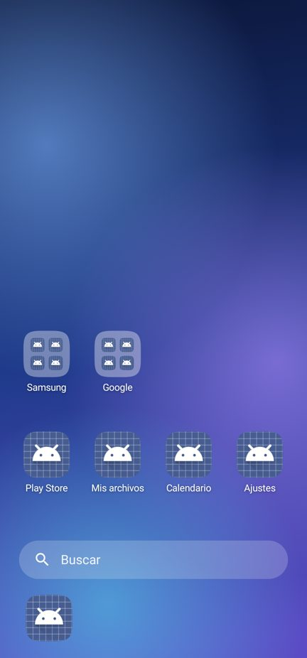
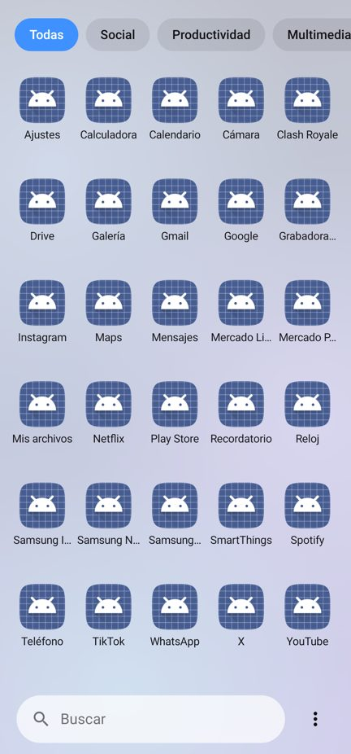
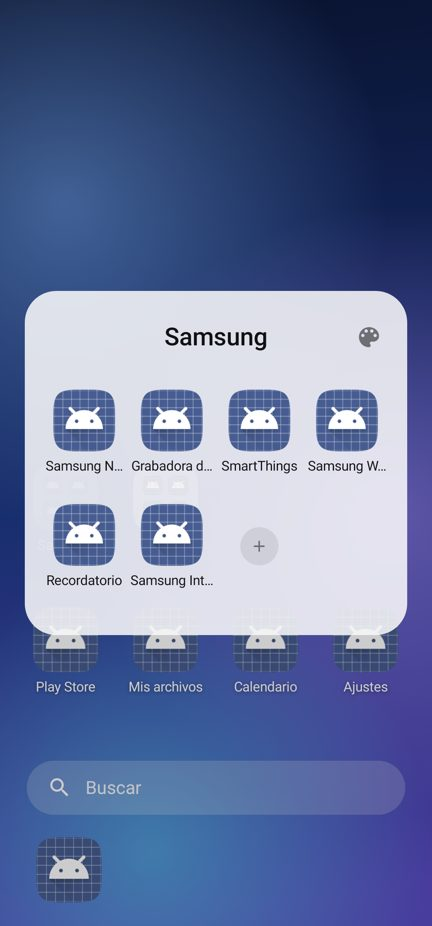
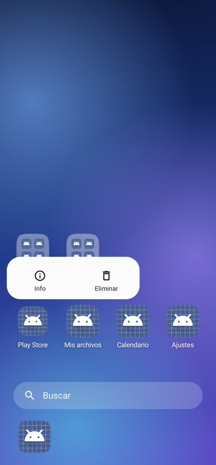
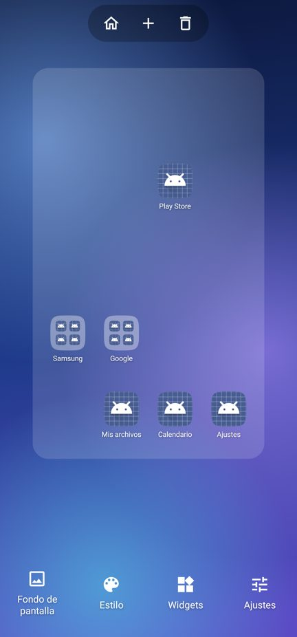
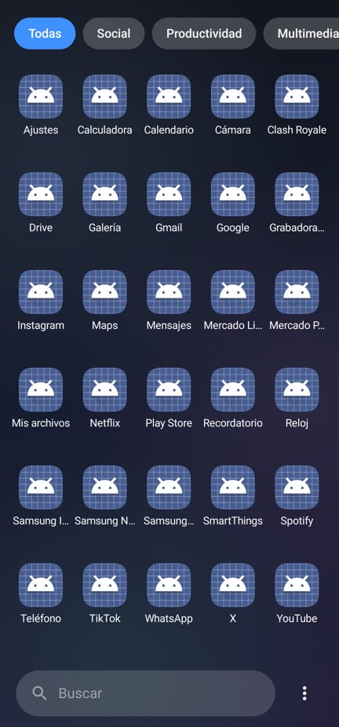
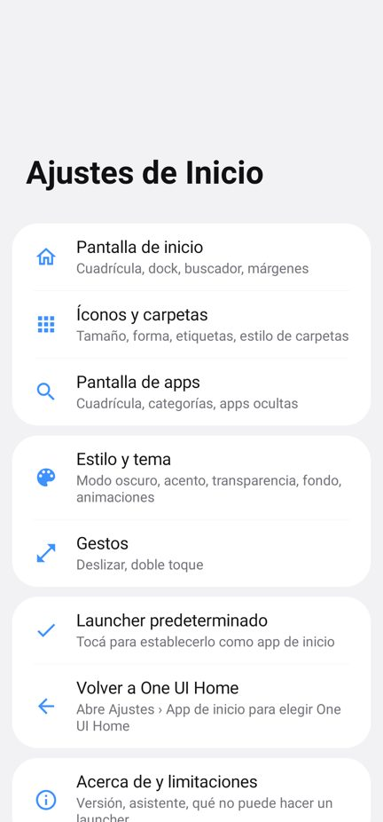
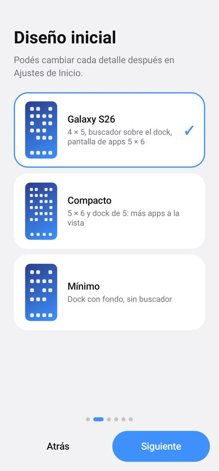

# Inicio S26 — launcher estilo Galaxy S26 Ultra / One UI 9 para S22 Ultra

App de inicio (launcher) nativa en Kotlin que reproduce la experiencia visual de One UI 9 en un
Galaxy S22 Ultra (SM-S908, Android 16 / One UI 8). **No es una ROM, no usa root ni modifica el
sistema**: se instala como cualquier APK, se elige como app de inicio y se desinstala cuando quieras.

| Inicio | Pantalla de apps | Carpeta | Menú contextual |
|---|---|---|---|
|  |  |  |  |
| **Modo edición** | **Oscuro** | **Ajustes** | **Asistente** |
|  |  |  |  |

> Capturas renderizadas con Robolectric (motor gráfico nativo de Android en JVM) a 1080×2314,
> 450 dpi (FHD+ del S22 Ultra). En el teléfono los íconos son los reales de cada app y el fondo
> se desenfoca con el blur del sistema.

## Descargas

| Archivo | Uso |
|---|---|
| `dist/InicioS26-1.0.1-release.apk` (240 KB) | Uso diario. Firma con llave propia. |
| `dist/InicioS26-1.0.1-debug.apk` (236 KB) | Pruebas. Depurable, firma de debug. |

Las dos firmas son distintas: para cambiar de una a otra hay que desinstalar primero.

## Documentación

- [Instalación y cómo hacerlo predeterminado / volver a One UI Home](docs/INSTALACION.md)
- [Funcionalidades y limitaciones](docs/FUNCIONALIDADES.md)
- [Diseño: referencias One UI 9 y decisiones](docs/DISENO.md)
- [Arquitectura, compilación y pruebas](docs/COMPILAR.md)
